# 雙機械手臂協作系統

兩支 PhantomX Pincher 手臂協作，用吸盤把瓶蓋從 A 區經 B 區交接，放到 C 區八個格位。整合了 ROS 2 Jazzy、MoveIt 2、Gazebo Harmonic、三相機 OpenCV，實機由一片 CM-530 控制八顆 AX-12A。

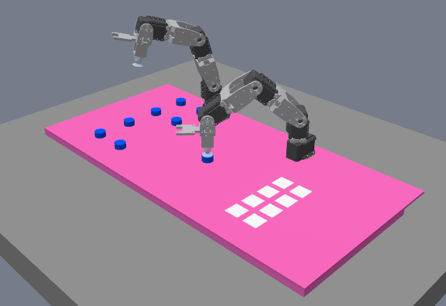

*Gazebo 模擬：Arm 2 在 B 區交接位置吸取瓶蓋，此時 Arm 1 已退回 HOME。*

## 從這裡開始

| 我想要 | 看這裡 |
|---|---|
| **在 Windows 或 Jetson Orin 上安裝和執行** | [安裝與使用指南](dual_arm_ws/README.md) |
| 了解目前進度和還缺什麼 | [PROGRESS.md](dual_arm_ws/docs/PROGRESS.md) |
| 查看測試結果 | [TEST_REPORT.md](dual_arm_ws/docs/TEST_REPORT.md) |
| 接手開發，或讓 AI 助手協助 | [AGENTS.md](dual_arm_ws/AGENTS.md) |
| 工作包、衝突清單、待決定事項 | [MODIFICATION_PLAN.md](dual_arm_ws/docs/MODIFICATION_PLAN.md) |
| **到現場測試實機** | [實機測試手冊](dual_arm_ws/docs/HARDWARE_TEST_GUIDE.md) |
| 測試計畫與放行階梯 | [TEST_PLAN.md](dual_arm_ws/docs/TEST_PLAN.md) |
| Orin 部署與實機步驟 | [ORIN_DEPLOYMENT.md](dual_arm_ws/docs/ORIN_DEPLOYMENT.md) |
| 中斷後續接 | [RESUME.md](dual_arm_ws/docs/RESUME.md) |
| 換到另一台電腦時給 AI 的 prompt | [HANDOFF_PROMPT_NEXT_COMPUTER.md](dual_arm_ws/docs/HANDOFF_PROMPT_NEXT_COMPUTER.md) |
| HOME 姿態與馬達數值換算 | [HOME_POSES.md](dual_arm_ws/docs/HOME_POSES.md) |
| CAD 檔案與限制 | [cad/README.md](dual_arm_ws/cad/README.md) |

最快的開始方式（完整步驟見[安裝與使用指南](dual_arm_ws/README.md)）：

```bash
git clone --recurse-submodules https://github.com/xian1022/dual_arm_system.git
```

## 目前狀態

| 功能 | 狀態 |
|---|---|
| 建置專案、Gazebo 模擬、RViz | ✅ 可用 |
| 兩物體 A→B→C 搬運（coordinator） | ✅ 模擬可用，含故障停止與人工復歸；區域與格位判斷用 Gazebo 真實座標 |
| CM-530 驅動、軟體安全監控 | 🟡 只測過 Mock Serial 與 MoveIt mock，還沒接實機 |
| 八物體完整搬運 | ❌ 未完成，目前模型只搆得到 4 個瓶蓋、7 個 C 格 |
| 視覺自動定位 | 🟡 模擬中取料點可由視覺決定；區域與格位還沒接，實體相機尚未校正 |
| ESP32 吸盤 | 🟡 程式完成，只用替身節點測過，還沒接實機 |
| Orin 部署 | 🟡 2026-11-10 已在 Orin 安裝、建置並通過離線測試與 Mock；唯讀連線 PASS，手動方向確認只做完 Arm 1 |
| 實機校正 | ❌ 未完成，需要現場量測 |

**實機控制預設關閉**，必須完成實測校正才能開啟。任務節點目前也會拒絕以實機模式啟動。

## 工作區配置

> 2026-11-10 實機量測（arm1）：手臂在遠離使用者側，A 區在手臂自身右方，使用者由左至右看到 A | B | C，模擬已改成這個配置，定義見 [COORDINATE_FRAMES.md](dual_arm_ws/docs/COORDINATE_FRAMES.md)。下方截圖已在新配置重新擷取（2026-11-10，`run_checks.sh t2`，[checks_20261110](dual_arm_ws/docs/evidence/checks_20261110/README.md)）。

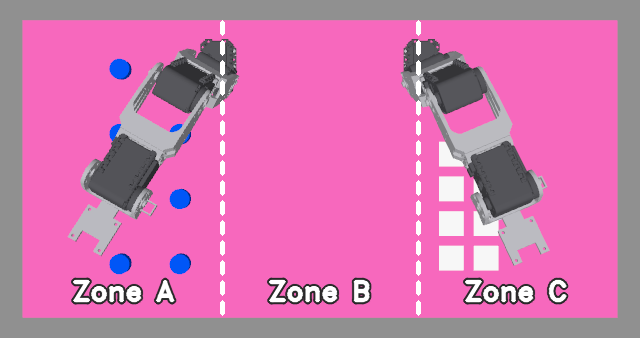

| 區域（使用者看過去） | 用途 | 負責手臂 |
|---|---|---|
| **A 區**（左） | 瓶蓋起始位置 | Arm 1 取物 |
| **B 區**（中） | 交接區，同一時間只有一支手臂能進入 | Arm 1 放下、Arm 2 取走 |
| **C 區**（右） | 八個白色放置格 | Arm 2 放置 |

兩支手臂在遠離使用者的長邊，面向使用者：Arm 1 的旋轉軸在 A/B 分界，Arm 2 在 B/C 分界。

泡棉板規格是 600 × 300 mm，三區各 200 × 300 mm，模擬也用這個尺寸。2026-11-10 現場推算短邊約 235 mm、旋轉軸在板外約 10 mm（模擬在板內約 63 mm），尚未直接量測，量完再修正模型。

## 搬運流程


這是目前 `dual_arm_coordinator` 的流程，一次只讓一支手臂動作。

| 1. HOME 預備 | 2. Arm 1 在 A 區取物 |
|:---:|:---:|
| 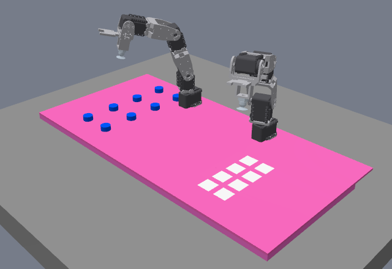 | 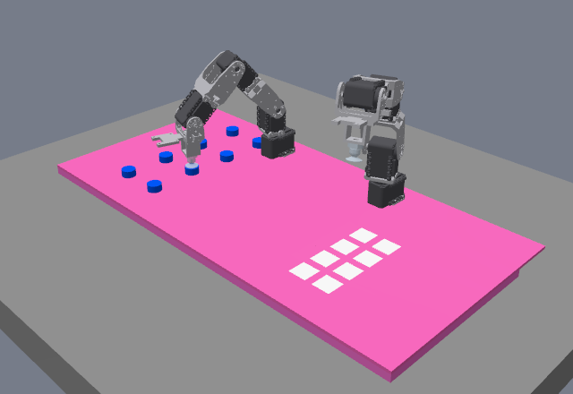 |
| **3. Arm 1 放到 B 區** | **4. Arm 2 在 B 區吸取** |
| 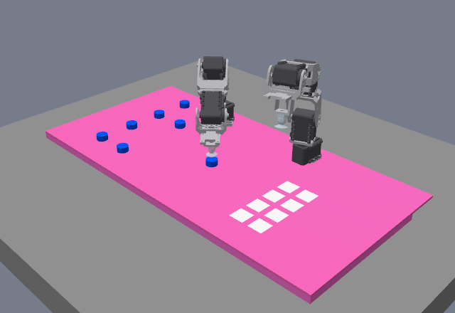 |  |
| **5. Arm 2 搬到 C 區** | **6. 兩物體放置完成，兩臂回 HOME** |
| 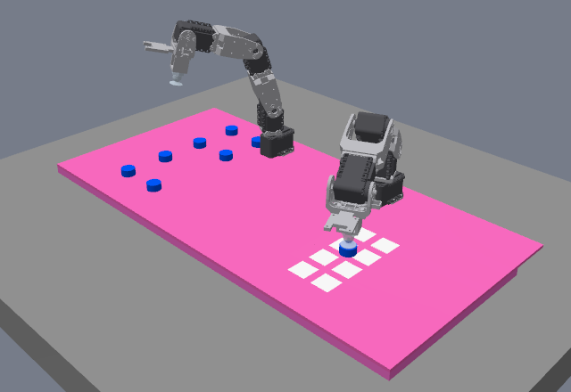 | 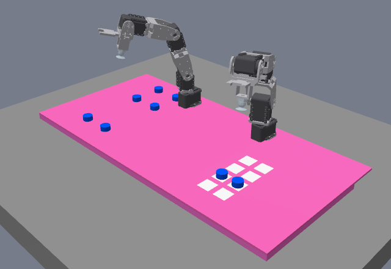 |

## 系統架構

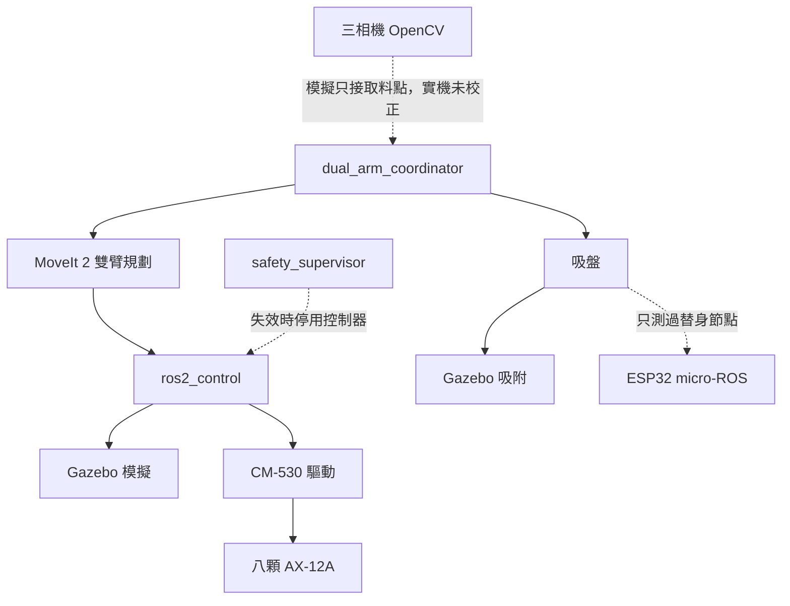

## 三相機畫面

| 環境相機 | Arm 1 相機（看 A 區） | Arm 2 相機（看 C 區） |
|:---:|:---:|:---:|
| 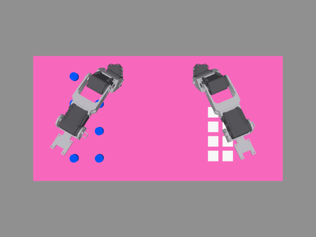 | 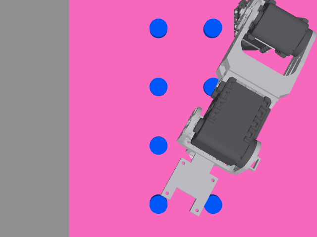 | 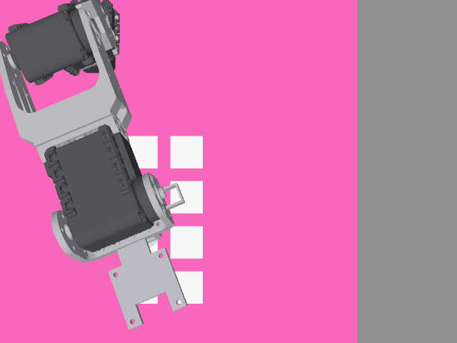 |

目前模擬中的相機固定在空間中，實機的手臂相機則裝在手臂末端。三顆實體相機都還沒校正；模擬中的相機有依已知幾何產生的校正，不能用在實機。

## 模擬與實機

| Gazebo 模型 | 實機 |
|:---:|:---:|
|  | 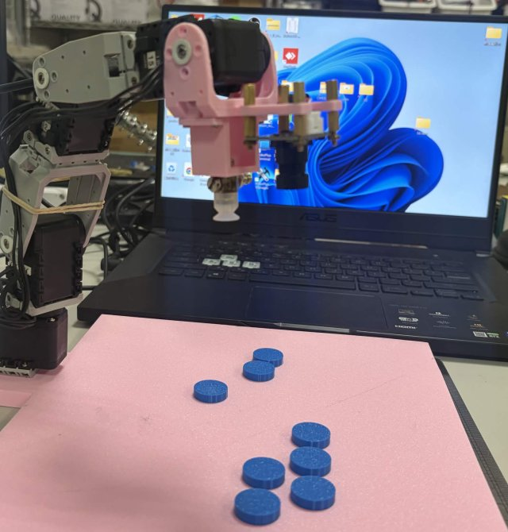 |

模型由 SolidWorks CAD 轉換而來。A 區方向與 Arm 1 的 j1 方向已和實機一致；零點、底座到板緣距離、板寬還沒依實測修正，Arm 2 也還沒確認方向。模擬成功不代表實機可以直接執行。

---

*畫面擷取自 2026-11-10 的 coordinator 兩物體搬運模擬，因為格位 1 目前搆不到，從格位 3 開始放。模型或流程改變後，用 `scripts/capture_readme_images.py` 重新擷取。*
