# 視覺導引雙臂協同搬運系統

兩支 PhantomX Pincher 手臂協作，用吸盤把物件從 A 區經 B 區交接，放到 C 區八個格位。整合了 ROS 2 Jazzy、MoveIt 2、Gazebo Harmonic、三相機 OpenCV，實機由一片 CM-530 控制八顆 AX-12A。

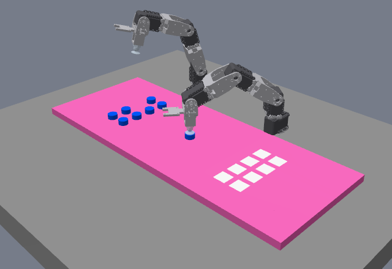

*Gazebo 模擬：Arm 2 在 B 區交接位置吸取物件，此時 Arm 1 已退回 HOME。*

## 從這裡開始

| 我想要 | 看這裡 |
|---|---|
| **在 Windows 或 Jetson Orin 上安裝和執行** | [安裝與使用指南](dual_arm_ws/README.md) |
| 了解目前進度和還缺什麼 | [PROGRESS.md](dual_arm_ws/docs/PROGRESS.md) |
| 查看測試結果 | [TEST_REPORT.md](dual_arm_ws/docs/TEST_REPORT.md) |
| 接手開發，或讓 AI 助手協助 | [AGENTS.md](dual_arm_ws/AGENTS.md) |
| 工作包、衝突清單、待決定事項 | [MODIFICATION_PLAN.md](dual_arm_ws/docs/MODIFICATION_PLAN.md) |
| 用操作介面啟動模擬與搬運 | [安裝與使用指南第 5 節](dual_arm_ws/README.md)、[UI_PLAN.md](dual_arm_ws/docs/UI_PLAN.md) |
| **到現場測試實機** | [實機測試手冊](dual_arm_ws/docs/HARDWARE_TEST_GUIDE.md) |
| 測試計畫與放行階梯 | [TEST_PLAN.md](dual_arm_ws/docs/TEST_PLAN.md) |
| Orin 部署與實機步驟 | [ORIN_DEPLOYMENT.md](dual_arm_ws/docs/ORIN_DEPLOYMENT.md) |
| 中斷後續接 | [RESUME.md](dual_arm_ws/docs/RESUME.md) |
| 換到另一台電腦時給 AI 的 prompt | [HANDOFF_PROMPT_NEXT_COMPUTER.md](dual_arm_ws/docs/HANDOFF_PROMPT_NEXT_COMPUTER.md) |
| HOME 姿態與馬達數值換算 | [HOME_POSES.md](dual_arm_ws/docs/HOME_POSES.md) |
| CM-530 韌體（指令、燒錄、測試） | [CM530_ROS_BRIDGE README](dual_arm_ws/third_party/CM530_ROS_BRIDGE/README.md) |
| CAD 檔案與限制 | [cad/README.md](dual_arm_ws/cad/README.md) |

最快的開始方式（完整步驟見[安裝與使用指南](dual_arm_ws/README.md)）：

```bash
git clone --recurse-submodules https://github.com/xian1022/dual_arm_system.git
```

## 目前狀態

| 功能 | 狀態 |
|---|---|
| 建置專案、Gazebo 模擬、RViz | ✅ 可用 |
| 兩物體 A→B→C 搬運（coordinator） | ✅ 模擬可用，含故障停止與人工復歸；區域與格位判斷用 Gazebo 真實座標 |
| CM-530 韌體第 18 版 | 🟡 2026-11-18 完成並通過所有不需硬體的測試，**尚未燒錄**。每筆 AX 同時寫入 Moving Speed，主機連線改成 1 Mbps（協定 6），目的是消除手臂卡頓與前後擺動。新驅動只接受第 18 版，板子還是第 17 版時會連線失敗 |
| CM-530 驅動、軟體安全監控 | 🟡 嚴格實機模式只測過 Mock Serial 與 MoveIt mock；驅動已在實機運作模式下帶動實機（估計校正，當時是第 17 版韌體）。2026-11-18 起每筆 AX 依軌跡速度帶 Moving Speed，Mock Serial 端對端 PASS |
| 八物體完整搬運 | 🟡 模擬可放滿 8 格（格位 8 用傾斜吸盤）；實機運作模式 2026-11-17 跑到 C 格 8（FULL），2026-11-18 12:55 一輪 9 次取件成功 8 次 |
| 視覺自動定位 | 🟡 模擬中取料點可由視覺決定。實機由環境相機（env_scene）判斷 A/B/C，手臂鏡頭只監控並輪流開；實機運作模式已用它找 A 區瓶蓋、確認 B 區與 C 格占用；env_scene 用上游 6b3d5c1（2026-11-13 現場尺量的 C 格位置），操作介面顯示它的框線影像 |
| ESP32 吸盤 | 🟡 實機運作模式的搬運流程已在使用（吸取自動確認，韌體沒有真空感測）。2026-11-13 E0 實測：重燒韌體（腳位 12/13/25/26），指令 1、2 是 arm1、3、4 是 arm2，約 1 秒吸穩。2026-11-18 起 agent 隨系統啟動，3 秒後自動用 RTS 重開 ESP32，不必再按 EN；「強制停止」「關閉系統」會讓吸盤全關 |
| 操作介面 | 🟡 模擬可啟停系統、開始、取消、強制停止、回 HOME、復歸；「實機運作模式」可上扭力、解除鎖定、回 HOME、開始，已在 Orin 使用；嚴格實機模式只接通強制停止 |
| 實機運作模式（Prototype） | 🟡 2026-11-13 起用估計校正讓實機跑完整流程（不要求精準，結果不算校正證據），介面選「實機運作模式」或 `hardware_prototype.launch.py`。B 區與 C 格用示教關節值（2026-11-18 重新示教）、A→B、B→C 不經 HOME、固定關節路徑、故障後自動續跑；每輪的分段時間記在 `~/.ros/dual_arm/timing/`。兩臂同時動作（overlap）已合入但預設關。見 [實機測試手冊](dual_arm_ws/docs/HARDWARE_TEST_GUIDE.md#prototype-模式) |
| Orin 部署 | 🟡 2026-11-18 Orin 的 `main` 在 `47b9b5c` 重建，測試與 Mock Serial PASS，之後的現場修正（`60b91ca`、`24e4c8f`）在 Orin 上直接修改並執行；嚴格模式的實機步驟只做到 H1。Orin 還沒更新到第 18 版韌體對應的程式（要拉取、重建、燒錄、設 latency timer） |
| 實機校正 | ❌ 未完成，需要現場量測 |

**嚴格實機控制預設關閉**，必須完成實測校正才能開啟，任務節點也會拒絕以嚴格實機模式（`mode: hardware`）啟動。實機運作模式是使用者 2026-11-13 決定的例外：用估計值跑完整流程，CM-530 電源開關是唯一急停，結果不能當成校正或 H 階段的證據。

## 工作區配置

> 2026-11-10 實機量測（arm1）：手臂在遠離使用者側，A 區在手臂自身右方，使用者由左至右看到 A | B | C，模擬已改成這個配置，定義見 [COORDINATE_FRAMES.md](dual_arm_ws/docs/COORDINATE_FRAMES.md)。2026-11-11 現場量到板寬、軸心位置與格位編號，模擬已依此更新（階段 C）；下方截圖在新配置重新擷取（2026-11-12，`run_checks.sh t2`，[phase_c_20261111](dual_arm_ws/docs/evidence/phase_c_20261111/README.md)）。

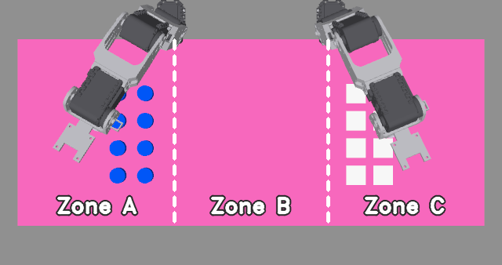

| 區域（使用者看過去） | 用途 | 負責手臂 |
|---|---|---|
| **A 區**（左） | 物件起始位置 | Arm 1 取物 |
| **B 區**（中） | 交接區，同一時間只有一支手臂能進入 | Arm 1 放下、Arm 2 取走 |
| **C 區**（右） | 八個白色放置格 | Arm 2 放置 |

兩支手臂在遠離使用者的長邊，面向使用者：Arm 1 的旋轉軸在 A/B 分界，Arm 2 在 B/C 分界。

泡棉板實測 600 × 240 mm（2026-11-11），三區各 200 × 240 mm，旋轉軸在靠手臂的長邊外約 5 mm，模擬已改成這些實測值。C 區格位依實物編號：1、2 最靠手臂，單號在靠 B 區的那一欄。

## 搬運流程


*流程總覽，可直接用在海報；向量檔是 [poster_flow.svg](dual_arm_ws/docs/images/poster_flow.svg)。圖中第 1 步是實機的設計：目前模擬的區域判斷用 Gazebo 真值，實機的環境相機流程還在等 Orin 驗證。*

### 詳細流程

一次只讓一支手臂動作。下圖是 `dual_arm_coordinator`（[workflow/](dual_arm_ws/src/dual_arm_coordinator/dual_arm_coordinator/workflow)）實際執行的步驟，方框裡的英文是 `/dual_arm/status` 顯示的狀態名稱。

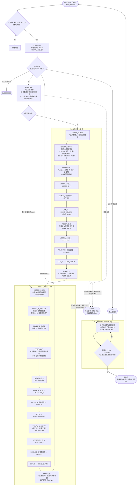

每一步開始前都會檢查取消與急停（`guard()`），watchdog 每 0.1 秒發布 `/dual_arm/permit`；安全監控失效時 `safety_supervisor` 會停用控制器。每一步的狀態都先寫入 journal 再動作，所以中斷後能知道手臂停在哪一步、手上有沒有東西。每一步的耗時（規劃、移動、到位、等相機、吸盤等待）會記成 `TIMING` 紀錄，任務結束印出 `TIMING SUMMARY`，CSV 寫在 journal 旁的 `timing/`。

### 實機運作模式和上圖的差異

實機運作模式（`config/prototype/coordinator.yaml`）在上圖的流程上加了幾個開關，模擬與嚴格實機模式不受影響：

| 設定 | 效果 |
|---|---|
| `b_teach`、`c_slot_teach` | B 區交接與 C 格放置直接到示教的關節值，不經 IK；接近點在示教點正上方，下降與抬起走關節直線 |
| `direct_transfer` | Arm 1 從 A 上方直接到 B 上方、Arm 2 從 B 上方直接到 C 上方，不再持物回 HOME；B 區互鎖在 PREFLIGHT 就取得，Arm 2 回 HOME 且相機看到 B 區已空才釋放 |
| `fixed_transits` | 非接觸移動（HOME、A/B/C 上方）先走關節直線，逐點通過碰撞檢查才執行，否則退回 MoveIt 規劃 |
| `a_pick_offset_xy_m`、`a_press_m`、`descent_correction` | A 區取料點偏移、多壓 6 mm；下降不足時再補一次（模型會碰撞時改為保留已到高度） |
| `auto_resume` | 故障後兩臂回 HOME、自動復歸並繼續剩下的件數，每次啟動最多 3 次；取消、急停或可能持物時不會續跑 |
| `overlap`（預設關） | 連續搬運：Arm 2 送 C 時 Arm 1 去 A 取下一件，兩臂同時動作，以 x 範圍預約避免碰撞；和 `direct_transfer` 不能同時開，只在 Mock Serial 與 Gazebo 試過 |

### 模擬畫面

| 1. HOME 預備 | 2. Arm 1 在 A 區取物 |
|:---:|:---:|
| 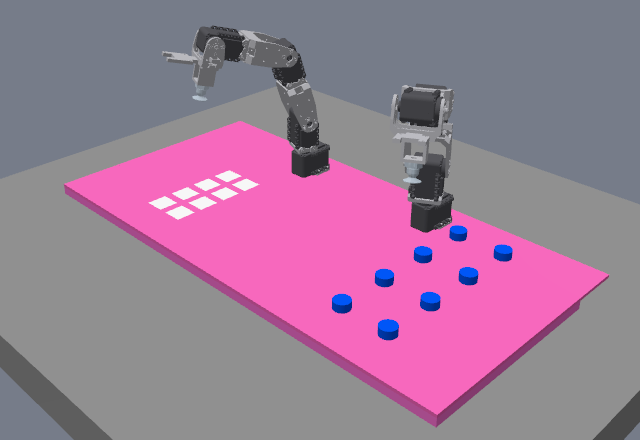 | 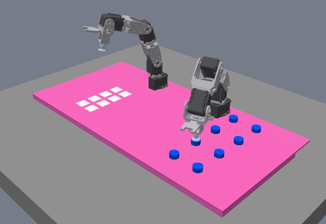 |
| **3. Arm 1 放到 B 區** | **4. Arm 2 在 B 區吸取** |
| 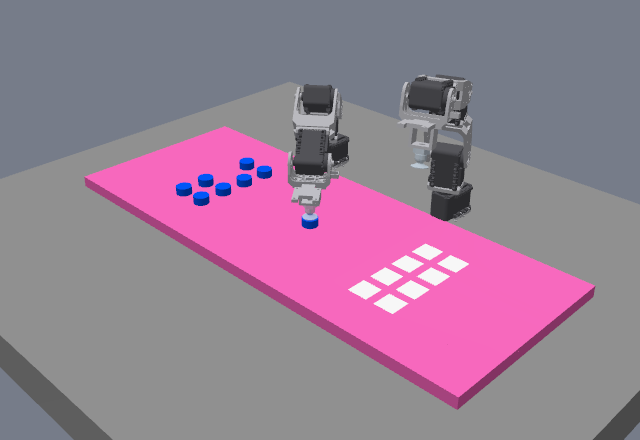 |  |
| **5. Arm 2 搬到 C 區** | **6. 兩物體放置完成，兩臂回 HOME** |
| 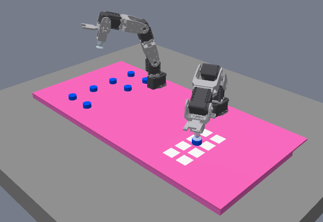 | 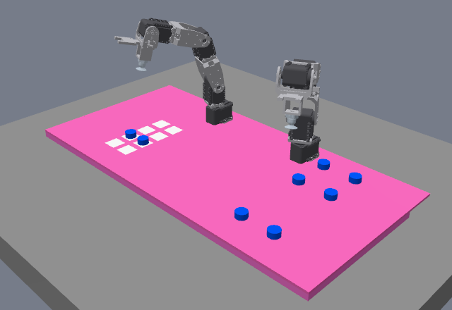 |

## 系統架構

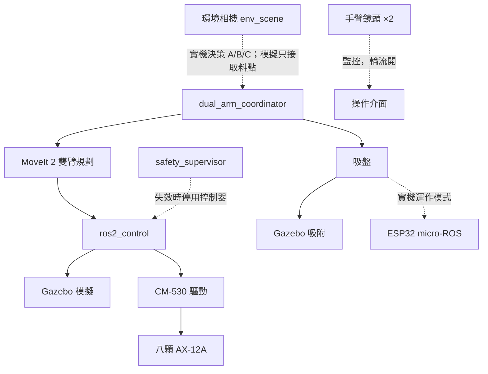

## 三相機畫面

| 環境相機 | Arm 1 相機（看 A 區） | Arm 2 相機（看 C 區） |
|:---:|:---:|:---:|
| 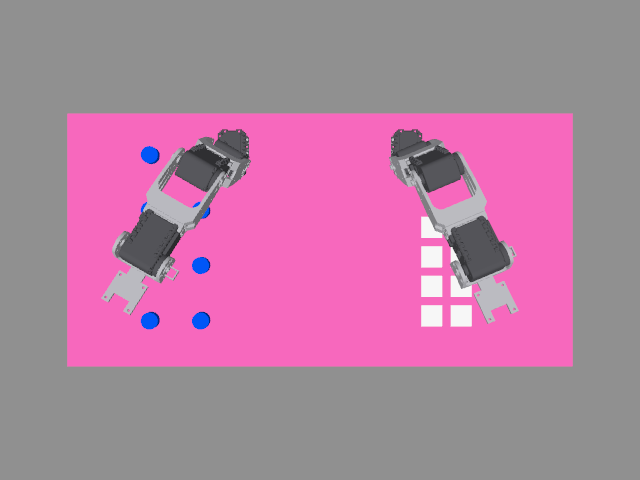 | 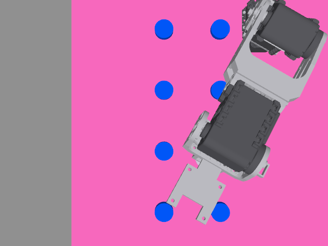 | 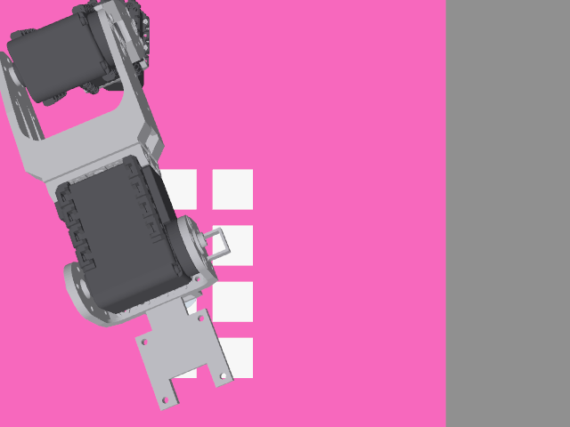 |

目前模擬中的相機固定在空間中，實機的手臂相機則裝在手臂末端。三顆實體相機都還沒校正；模擬中的相機有依已知幾何產生的校正，不能用在實機。

## 操作介面

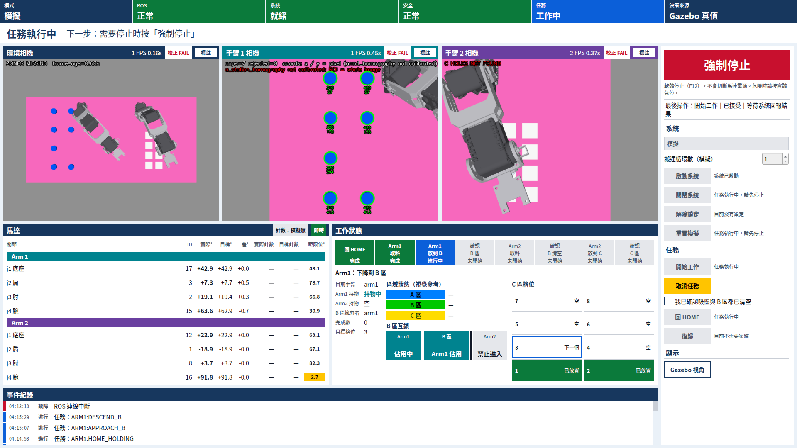

*2026-11-12 在 Gazebo 模擬中實際擷取（階段 C 後重拍）：Arm 1 持物下降到 B 區，B 區互鎖由 Arm 1 佔用，Arm 2 禁止進入。*

用 `ros2 run dual_arm_hmi hmi` 開啟，可以啟動與關閉模擬、開始工作、取消、強制停止、解除鎖定、回 HOME、復歸。「實機運作模式」另外開放上扭力，啟動時一起帶起 ESP32 的 micro-ROS agent；嚴格實機模式只接通強制停止。用法見[安裝與使用指南第 5 節](dual_arm_ws/README.md)，規格見 [UI_PLAN.md](dual_arm_ws/docs/UI_PLAN.md)。畫面說明：模擬相機在介面使用的 `~/.ros/dual_arm_calib/sim` 沒有產生校正，三格都標「校正 FAIL」；區域狀態只是視覺參考，任務決策用 Gazebo 真值（右上「決策來源」）。環境相機在目前配置開機時找不到場地，顯示 `ZONES MISSING`。C 區格位圖依實物編號，1 號在左上（2026-11-12 階段 C）。事件紀錄的故障會置頂。

## 模擬與實機

| Gazebo 模型 | 實機 |
|:---:|:---:|
|  | 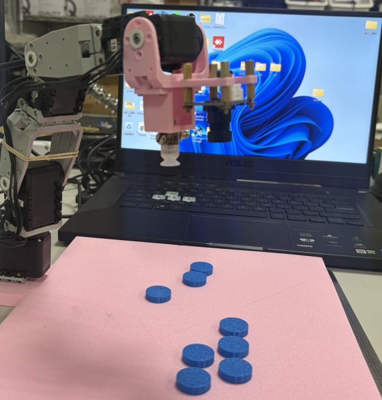 |

模型由 SolidWorks CAD 轉換而來。A 區方向與 Arm 1 的 j1 方向已和實機一致；板寬、軸心到板緣距離與格位已依 2026-11-11 實測修正，Arm 2 的 j1 方向也已確認；各軸零點還沒校正（要等 H2）。模擬成功不代表實機可以直接執行。

---

*畫面擷取自 2026-11-12 的 coordinator 兩物體搬運模擬，從空的 C 區開始，放到格位 1、2。模型或流程改變後，用 `scripts/capture_readme_images.py` 重新擷取。*
