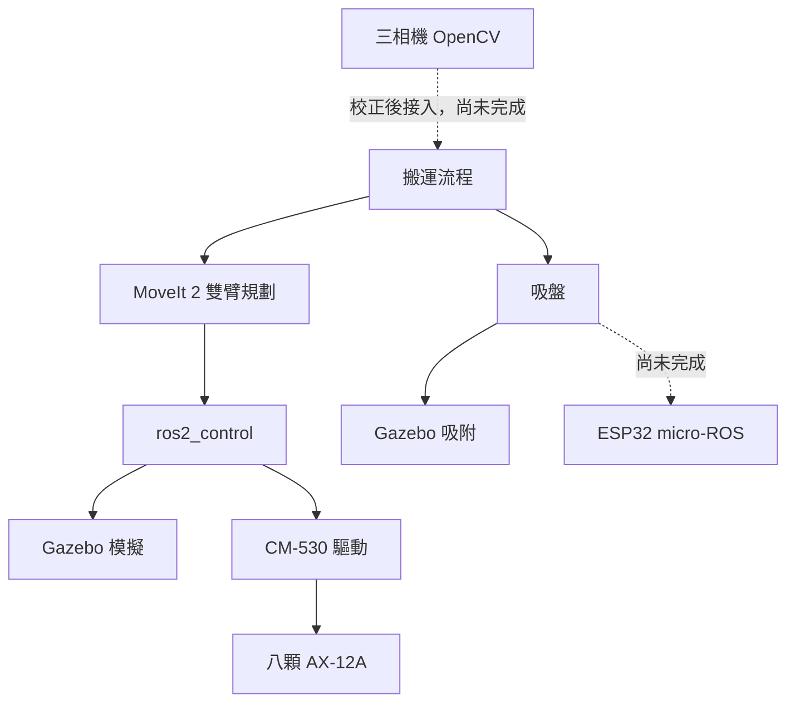

# 雙機械手臂協作系統

兩支 PhantomX Pincher 手臂協作，用吸盤把瓶蓋從 A 區經 B 區交接，放到 C 區八個格位。整合了 ROS 2 Jazzy、MoveIt 2、Gazebo Harmonic、三相機 OpenCV，實機由一片 CM-530 控制八顆 AX-12A。


*Gazebo 模擬：Arm 2 在 B 區取物，Arm 1 同時回 A 區取下一個瓶蓋。*

## 從這裡開始

| 我想要 | 看這裡 |
|---|---|
| **在 Windows 或 Jetson Orin 上安裝和執行** | [安裝與使用指南](dual_arm_ws/README.md) |
| 了解目前進度和還缺什麼 | [PROGRESS.md](dual_arm_ws/docs/PROGRESS.md) |
| 查看測試結果 | [TEST_REPORT.md](dual_arm_ws/docs/TEST_REPORT.md) |
| 接手開發，或讓 AI 助手協助 | [AGENTS.md](dual_arm_ws/AGENTS.md) |
| 中斷後續接 | [RESUME.md](dual_arm_ws/docs/RESUME.md) |
| HOME 姿態與馬達數值換算 | [HOME_POSES.md](dual_arm_ws/docs/HOME_POSES.md) |
| CAD 檔案與限制 | [cad/README.md](dual_arm_ws/cad/README.md) |

最快的開始方式（完整步驟見[安裝與使用指南](dual_arm_ws/README.md)）：

```bash
git clone --recurse-submodules https://github.com/xian1022/dual_arm_system.git
```

## 目前狀態

| 功能 | 狀態 |
|---|---|
| 建置專案、Gazebo 模擬、RViz | ✅ 可用 |
| 兩物體 A→B→C 搬運 | ✅ 可用（使用 Gazebo 真實座標） |
| CM-530 驅動 | 🟡 只測過 Mock Serial，還沒接實機 |
| 八物體完整搬運 | ❌ 未完成，目前模型只搆得到 4 個瓶蓋、7 個 C 格 |
| 視覺自動定位 | ❌ 未完成，相機尚未校正 |
| 實機校正、ESP32 吸盤、Orin 部署 | ❌ 未完成 |

**實機控制預設關閉**，必須完成實測校正才能開啟。

## 工作區配置


| 區域 | 用途 | 負責手臂 |
|---|---|---|
| **A 區**（右） | 瓶蓋起始位置 | Arm 1 取物 |
| **B 區**（中） | 交接區，同一時間只有一支手臂能進入 | Arm 1 放下、Arm 2 取走 |
| **C 區**（左） | 八個白色放置格 | Arm 2 放置 |

泡棉板 600 × 300 mm，三區各 200 × 300 mm。

## 搬運流程


| 1. HOME 預備 | 2. Arm 1 在 A 區取物 |
|:---:|:---:|
|  |  |
| **3. Arm 1 放到 B 區** | **4. Arm 2 接手，Arm 1 取下一個** |
|  |  |
| **5. Arm 2 搬往 C 區** | **6. 兩物體放置完成** |
|  |  |

## 系統架構



## 三相機畫面

| 環境相機 | Arm 1 相機（看 A 區） | Arm 2 相機（看 C 區） |
|:---:|:---:|:---:|
|  |  |  |

目前模擬中的相機固定在空間中，實機的手臂相機則裝在手臂末端。三顆相機都還沒校正。

## 模擬與實機

| Gazebo 模型 | 實機 |
|:---:|:---:|
|  |  |

模型由 SolidWorks CAD 轉換而來。實機與模擬的零位、底座位置都還需要實測核對，模擬成功不代表實機可以直接執行。

---

*畫面擷取自 2026-11-09 的兩物體搬運模擬，對應 commit `6feea97`。模型或流程改變後請重新擷取。*
