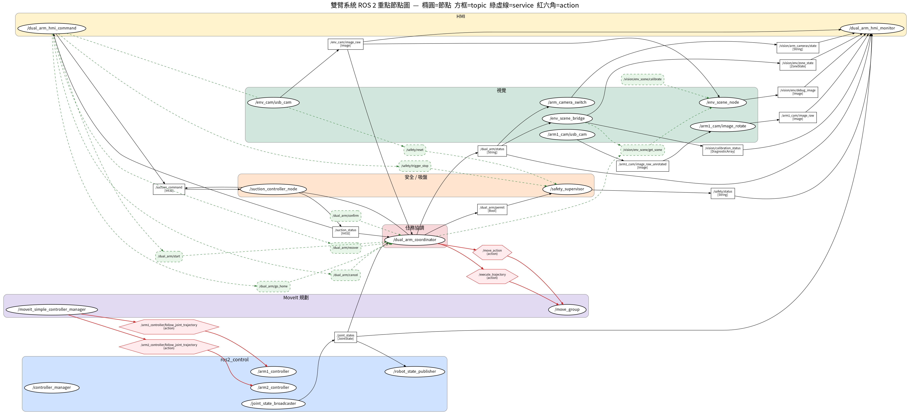

# ROS 2 節點圖

擷取時間：2026-11-19，Orin 實機，整套系統啟動中（25 個節點）。圖是當下 graph 的快照，節點或介面改了要重新產生。



## 檔案

| 檔案 | 內容 |
|---|---|
| [ros_graph_focus.png](ros_graph_focus.png) / [.svg](ros_graph_focus.svg) | 重點圖：主流程 18 個節點，依功能分組，含應用層 service 與 action |
| [ros_graph_clean.svg](ros_graph_clean.svg) | 去雜訊全圖：拿掉 `/rosout`、`/parameter_events`、參數 service、工具節點 |
| [ros_graph_full.svg](ros_graph_full.svg) | 完整圖：所有節點、topic、service、action，不過濾 |
| `*.dot` | 上面三張圖的 Graphviz 原始檔 |
| [gen_ros_graph.py](gen_ros_graph.py) | 產生上面三張圖的腳本 |
| [dual_arm_focus.perspective](dual_arm_focus.perspective) | rqt perspective，開啟後就是重點過濾的 rqt_graph |

圖例：橢圓＝節點、方框＝topic、綠色虛線框＝service、紅色六角形＝action。

## 重點圖怎麼看

- **HMI → 協調器**：`/dual_arm_hmi_command` 呼叫 `/dual_arm/start`、`confirm`、`cancel`、`go_home`、`recover`。
- **協調器 → 手臂**：`/dual_arm_coordinator` 經 `/move_action`、`/execute_trajectory` 交給 `/move_group`；`/moveit_simple_controller_manager` 再經 `follow_joint_trajectory` 送到 `arm1_controller`、`arm2_controller`。
- **安全**：協調器發 `/dual_arm/permit` 給 `/safety_supervisor`，並訂閱 `/safety/estop`。
- **吸盤**：`/suction_command` ↔ `/suction_status`。
- **視覺**：協調器呼叫 `/vision/env_scene/get_scene`；各狀態 topic 匯到 `/dual_arm_hmi_monitor`。

重點圖裡 `/controller_manager` 沒有連線，因為它跟其他節點只靠 service 和統計 topic 連接，這些被過濾掉了。

## 重新產生

系統啟動後，在這個資料夾執行：

```bash
source /opt/ros/jazzy/setup.bash && source ../../install/setup.bash
python3 gen_ros_graph.py ros_graph
for v in focus clean full; do dot -Tsvg ros_graph_$v.dot -o ros_graph_$v.svg; done
dot -Tpng -Gdpi=110 ros_graph_focus.dot -o ros_graph_focus.png
```

腳本會等到節點數穩定 3 秒（最多 20 秒）才讀 graph，避免漏掉還沒被發現的節點。重點圖保留哪些節點、過濾哪些 topic，寫在腳本後段的 `GROUPS`、`DROP_T_SUB`、`KEEP_S_PREFIX`。

## 用 rqt 開

```bash
rqt --perspective-file dual_arm_focus.perspective
```

開起來後要按一次左上角的 🔄。rqt 啟動時只讀一次 graph，那時節點常常還沒被發現，所以第一次畫面會是空的。rqt_graph 不畫 service，要看 service 請看上面的 PNG／SVG。
